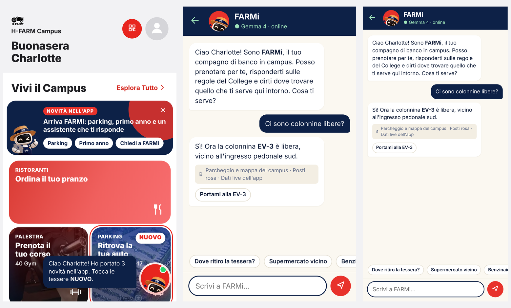

[README.md](https://github.com/user-attachments/files/33910110/README.md)
# FARMi · l'assistente del campus H-FARM, con Gemma 4

> Hacktoberfest @ H-FARM · H-OS challenge · open source (MIT)

FARMi è una **webapp per telefono** che estende l'app H-FARM Campus con tre novità: **Parking** (ritrova l'auto, colonnine e posti riservati), **Primo anno** (la prima settimana da matricola) e **FARMi**, una chat che risponde con **Gemma 4** usando una **knowledge base in Markdown**, i **regolamenti** e i **dati live dell'app**. Ogni risposta cita le sue fonti. Le altre sezioni (Palestra, Ristoranti, Shop…) sono quelle dell'app esistente e restano invariate.

<p align="center"></p>

**Indice:** [Provala sul telefono](#provala-sul-telefono) · [Avviala sul tuo PC](#avviala-sul-tuo-pc) · [Mettere la demo online](#mettere-la-demo-online-per-il-team) · [Knowledge base](#demo-live-della-knowledge-base) · [Come funziona](#come-funziona) · [Problemi frequenti](#problemi-frequenti)

---

## Provala sul telefono

Apri **👉 https://farmi.onrender.com** <!-- TODO: sostituire con l'indirizzo reale dopo il deploy --> e mettila nella Home: da lì si apre a schermo intero, come un'app.

| iPhone (Safari) | Android (Chrome) |
|---|---|
| 1. Apri il link con **Safari** | 1. Apri il link con **Chrome** |
| 2. Tocca **Condividi** (il quadrato con la freccia ⬆︎) | 2. Tocca **Installa** nel banner, oppure il menu **⋮** |
| 3. Scegli **Aggiungi alla schermata Home** → **Aggiungi** | 3. Scegli **Installa app** (o **Aggiungi a schermata Home**) |

FARMi stessa lo ricorda con un piccolo banner la prima volta che la apri.

> La demo gira su un piano gratuito: se nessuno la usa da un po', la prima apertura può impiegare fino a un minuto. Poi è veloce.

---

## Avviala sul tuo PC

### 1 · Installa Node.js (una volta sola)

Serve **Node.js 18 o più recente**. Controlla se ce l'hai già:

```bash
node -v
```

Se il comando non esiste o la versione è più bassa di `v18`:

| Sistema | Il modo più semplice | Da terminale |
|---|---|---|
| **Windows** | Scarica l'installer **LTS** da [nodejs.org](https://nodejs.org/it/download) e clicca *Avanti* fino alla fine | `winget install OpenJS.NodeJS.LTS` |
| **macOS** | Scarica l'installer **LTS** da [nodejs.org](https://nodejs.org/it/download) | `brew install node` (serve [Homebrew](https://brew.sh)) |
| **Linux** (Ubuntu/Debian) | — | `curl -fsSL https://deb.nodesource.com/setup_22.x \| sudo -E bash -` poi `sudo apt-get install -y nodejs` |

Dopo l'installazione **chiudi e riapri il terminale**, poi rifai `node -v`.

Non serve altro: il progetto **non ha dipendenze**, quindi niente `npm install`.

### 2 · Scarica il progetto

**Senza Git (più semplice):** in alto in questa pagina clicca **Code → Download ZIP**, estrai lo zip e apri un terminale dentro la cartella estratta.

> Come aprire un terminale nella cartella: su **Windows** apri la cartella, clicca sulla barra dell'indirizzo, scrivi `cmd` e premi Invio. Su **macOS** tasto destro sulla cartella → *Nuovo terminale nella cartella*.

**Con Git:**

```bash
git clone https://github.com/<utente>/farmi-h-os.git
cd farmi-h-os
```

Git non ce l'hai? [git-scm.com/downloads](https://git-scm.com/downloads) · Windows: `winget install Git.Git` · macOS: `xcode-select --install` · Linux: `sudo apt install git`

### 3 · Avvia

```bash
npm start
```

Apri **http://localhost:3000**. Fatto.

Senza configurare nulla, la chat usa il **server demo del team** (e quindi la sua chiave, che resta al sicuro online). Il terminale mostra anche un indirizzo tipo `http://192.168.1.20:3000`: aprilo dal telefono collegato alla **stessa Wi-Fi** per provarla lì.

### Vuoi usare una tua chiave o Gemma sul tuo PC?

```bash
npm run setup
```

Ti fa scegliere:

1. **Google AI Studio** – la tua chiave gratuita da [aistudio.google.com/apikey](https://aistudio.google.com/apikey). Necessaria se vuoi modificare la knowledge base e vedere subito l'effetto.
2. **Ollama** – Gemma 4 gira sul tuo computer, senza chiave e senza internet. Installa [Ollama](https://ollama.com), poi `ollama pull gemma4` (~10 GB; per PC leggeri `ollama pull gemma4:e2b`).
3. **Server demo** – nessuna chiave (è quello che succede di default).

Alla fine fa una domanda di prova a Gemma per verificare che tutto funzioni. La configurazione va nel file `.env`, che **non finisce mai su GitHub**.

---

## Mettere la demo online (per il team)

Si fa **una volta sola**. La chiave API si inserisce nel pannello di Render, **non nel codice**: così chiunque usa la demo con la chiave del team, ma nessuno può copiarla.

1. Crea un account gratuito su [render.com](https://render.com) entrando con GitHub.
2. **New → Blueprint** e scegli questo repository: Render legge `render.yaml` e prepara tutto.
3. Quando chiede **GEMINI_API_KEY**, incolla la chiave da [aistudio.google.com/apikey](https://aistudio.google.com/apikey). Conferma con **Apply**.
4. Dopo un paio di minuti la demo è su un indirizzo tipo `https://farmi.onrender.com`.
5. Metti quell'indirizzo in `server.js` (`DEFAULT_DEMO_SERVER = 'https://…'`) e in cima a questo README, poi fai commit. Da quel momento chi scarica il repo e lancia `npm start` usa il server demo.

Ogni `git push` su `main` aggiorna la demo da solo.

**Protezione della quota gratuita.** Il server limita le domande a **8 al minuto e 150 al giorno per persona**, e **1.200 al giorno in totale**; i valori si cambiano da Render (`RATE_LIMIT_PER_MIN`, `RATE_LIMIT_PER_DAY`, `DAILY_CAP`). Se la quota finisce, la chat passa da sola alle risposte demo offline. Se la chiave venisse abusata, si rigenera su AI Studio e si aggiorna su Render: il codice non cambia.

---

## Demo live della knowledge base

> Serve un server con la **sua** chiave (o Ollama): con il server demo le risposte arrivano dalla knowledge base online.

1. Chiedi a FARMi: *"A che ora apre lo Student Office?"*
2. Apri `knowledge/01-student-office.md` e cambia l'orario (es. 9:00 → 8:30). Salva.
3. Rifai la domanda: la risposta cambia subito, senza riavviare, e cita il documento.

Per aggiungere conoscenza crea un file `.md` in `knowledge/`: ogni titolo `## ...` diventa una sezione citabile.

```markdown
---
title: Biblioteca
owner: Library
updated: 2026-10-30
---
## Orari
La biblioteca è aperta dal lunedì al venerdì, 8:30–19:00.
```

Cosa ha caricato il server: http://localhost:3000/api/knowledge

### Regolamenti: FARMi dice cosa non si può fare

Un file con `type: regolamento` nell'intestazione viene trattato come **regola vincolante**. Se uno studente chiede qualcosa che il regolamento vieta (*"Posso portare il cane a lezione?"*), FARMi risponde che non è consentito, cita **articolo e comma** e propone l'alternativa permessa. Nella chat compare il riquadro rosso *Non consentito · Art. 2, comma 1*. Articoli inventati dal modello vengono scartati dal server.

```markdown
---
title: Regolamento per l'accesso al campus
type: regolamento
---
## Art. 2 – Animali
1. Gli animali non possono entrare in aule, biblioteca, palestra e ristoranti.
2. Fanno eccezione i cani di assistenza, segnalati prima allo Student Office.
```

`knowledge/10-regolamento-campus.md` è un **esempio scritto dal team**, non il regolamento ufficiale: va sostituito con i documenti pubblici di [H-FARM College · Policies & Regulations](https://college.h-farm.com/en/h-farm-college/policies-regulations/).

---

## Come funziona

```
Telefono / browser                      server.js (Node, zero dipendenze)            Gemma 4
 ┌──────────────────────┐ POST /api/chat ┌─────────────────────────────┐   ┌────────────────────┐
 │ FARMi (webapp, PWA)  │ ─────────────► │ 1. limite richieste         │──►│ Google AI Studio   │
 │ chat + contesto live:│ messaggi +     │ 2. legge knowledge/*.md     │   │ gemma-4-26b-a4b-it │
 │ colonnine, auto,     │ dati live      │ 3. prompt con fonti [S1..]  │   │   oppure           │
 │ ristoranti aperti    │ ◄───────────── │ 4. valida fonti e azioni    │◄──│ Ollama · gemma4    │
 └──────────────────────┘ risposta+fonti └─────────────────────────────┘   └────────────────────┘
```

- **Fonti verificate.** Il modello cita gli id delle sezioni (`S1`, `S2`, … o `LIVE`); il server li trasforma in nomi di documento e scarta quelli inventati.
- **Azioni sicure.** Il modello può solo proporre pulsanti da una lista chiusa (guida al posto EV-3, mappa verso lo Student Office…). Nulla parte finché l'utente non tocca il pulsante.
- **Passaggio a una persona.** Su retta, eccezioni, salute o domande senza fonte, FARMi non improvvisa e passa allo Student Office.
- **Sempre in piedi.** Se l'AI non risponde (niente rete, quota finita), la chat usa le risposte demo offline e lo scrive nell'intestazione.

Dettagli in [docs/ARCHITECTURE.md](docs/ARCHITECTURE.md).

## Struttura

```
public/index.html          l'app (un solo file HTML)
public/manifest.webmanifest, sw.js, icons/   per installarla sul telefono
server.js                  server + collegamento a Gemma 4
knowledge/*.md             knowledge base (dati sintetici)
scripts/setup.js           configurazione guidata
render.yaml                deploy su Render in un clic
test/                      test senza rete: npm test
```

## Configurazione (`.env`)

| Variabile | Default | Cosa fa |
|---|---|---|
| `LLM_PROVIDER` | automatico | `google`, `ollama` o `remote`. Senza chiave usa il server demo |
| `GEMINI_API_KEY` | — | chiave gratuita da aistudio.google.com/apikey |
| `GEMMA_MODEL` | `gemma-4-26b-a4b-it` | oppure `gemma-4-31b-it` (più lento, più accurato) |
| `OLLAMA_URL` / `OLLAMA_MODEL` | `http://localhost:11434` / `gemma4` | Gemma in locale |
| `REMOTE_URL` | server demo del team | dove inoltrare la chat quando non c'è una chiave |
| `RATE_LIMIT_PER_MIN` / `_PER_DAY` / `DAILY_CAP` | `8` / `150` / `1200` | protezione della quota gratuita |
| `PORT` | `3000` | porta del server |

## Problemi frequenti

| Problema | Soluzione |
|---|---|
| `node` non è riconosciuto / `command not found` | Installa Node.js (passo 1) e **riapri il terminale**. |
| Windows: *"npm.ps1 cannot be loaded… running scripts is disabled"* | Usa il **Prompt dei comandi** (`cmd`) invece di PowerShell, oppure esegui una volta `Set-ExecutionPolicy -Scope CurrentUser RemoteSigned`. |
| `EADDRINUSE` | La porta 3000 è occupata: `PORT=3001` in `.env` (Windows: `set PORT=3001 && npm start`). |
| Chat: *Modalità demo offline* | Nessuna chiave e nessun server demo raggiungibile: lancia `npm run setup`. |
| *Il server demo non risponde* | Si sta svegliando dal piano gratuito: riprova tra 30–60 secondi. |
| *Troppe domande in un minuto* | Limite anti-abuso: aspetta qualche secondo. |
| *Ollama non risponde* | Apri l'app Ollama e verifica `ollama pull gemma4`. |
| Dal telefono non si apre `192.168…` | Telefono e PC devono essere sulla **stessa Wi-Fi**; su Windows consenti Node nel firewall. Le reti del campus spesso bloccano: usa la demo online. |
| iPhone: manca "Aggiungi alla schermata Home" | Funziona solo in **Safari**, non da Chrome o dall'app di Instagram/WhatsApp. |

## Dati e regole (guardrail della challenge)

- Solo **dati sintetici o pubblici**: nessun dato personale reale, nessun accesso ai sistemi di H-FARM.
- Le azioni (prenotazioni, ticket, ordini) sono **simulate** nell'app.
- FARMi non monitora né valuta le persone.
- Nessuna chiave o segreto nel repository.

## Licenza

[MIT](LICENSE)
